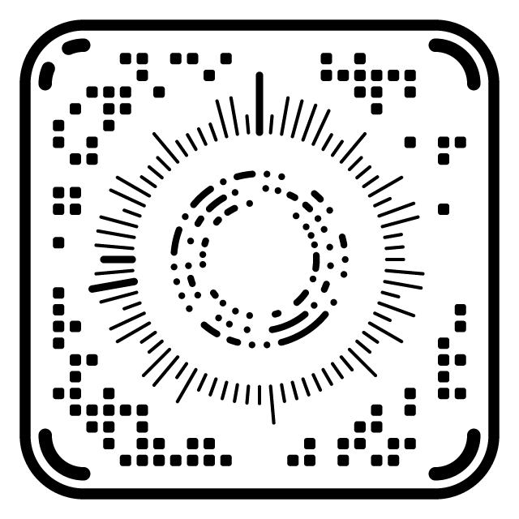
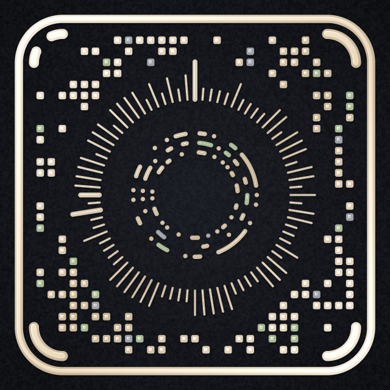
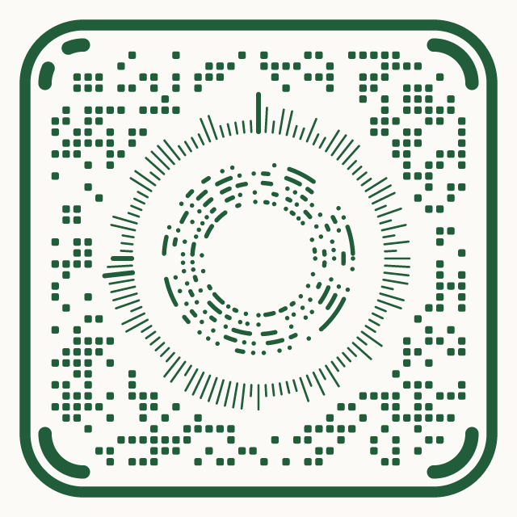
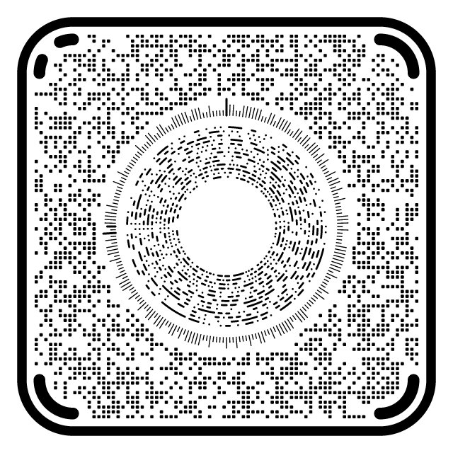

# CKey

CKey is an open, independent 2D optical code. A rounded-square field with corner finders surrounds a polar centre of rays, dots, rings and arcs. It carries links, text, contact cards and any bytes, protected by Reed–Solomon error correction, and it can be styled without breaking scanning.

This repository holds the reference implementation: the C core, SDKs for Swift, the web, Android and .NET, a command-line tool, and the format specifications. It is MIT-licensed. [openckey.org](https://openckey.org) is the only official home of CKey.

<p align="center">
  
  
  
  
  
</p>

Every image above is rendered by the core and read back by the real decoder. See the [gallery](docs/gallery/README.md) for what each one holds and how it certifies.

> **Status: experimental.** The formats are drafts and may change before 1.0. Decoding is tested on rendered and simulated camera images; real-camera robustness and speed have not been measured yet, so no claims are made about them.

## Install

The current release is **`0.1.0-build.78`**. Every package wraps the same C core.

| Platform | Package | Install |
|---|---|---|
| iOS, macOS (Swift) | Swift package `CKey` | Xcode: **File → Add Package Dependencies…** → `https://github.com/clearkeysolutions/ckey` |
| Web, Node (WebAssembly) | npm `ckey` | `npm install ckey` |
| Android (Kotlin) | Maven `org.openckey:ckey` | `implementation("org.openckey:ckey:0.1.0-build.78")` |
| .NET | NuGet `CKey` | `dotnet add package CKey` |
| Command line | Homebrew `ckey` | `brew install clearkeysolutions/ckey/ckey` |
| C and C++ | CMake package `CKey` | Build from source (below), then `find_package(CKey)` |

Release archives for every package, with `SHA256SUMS` and build provenance, are on the [GitHub Releases](https://github.com/clearkeysolutions/ckey/releases) page and at [openckey.org/downloads](https://openckey.org/downloads). Check the SHA-256 of anything you download.

### Swift

```swift
// Package.swift
.package(url: "https://github.com/clearkeysolutions/ckey", from: "0.1.0-build.78"),
.target(name: "MyApp", dependencies: [.product(name: "CKey", package: "ckey")]),
```

```swift
import CKey

let symbol = try CKeySymbol.encode("https://openckey.org")
let image: CGImage = try symbol.cgImage(size: 1024)
let pdf: Data = try symbol.pdfData(widthPoints: 144)        // 2 inches wide
```

`CKeyScanner` (module `CKeyScanKit`) is a scan-only product with no renderer and no telemetry. See [sdk/swift](sdk/swift/README.md).

### Web

```js
import { loadCKey } from 'ckey';

const ckey = await loadCKey();
const sym = ckey.encode('https://openckey.org');
ckey.renderToCanvas(sym, document.querySelector('canvas'), { size: 512 });
const png = ckey.renderPNG(sym, { size: 1024 });
sym.free();
```

See [sdk/web](sdk/web/README.md).

### Android

```kotlin
dependencies {
    implementation("org.openckey:ckey:0.1.0-build.78")
    implementation("org.openckey:ckey-compose:0.1.0-build.78")   // optional: CKeyImage
    implementation("org.openckey:ckey-camerax:0.1.0-build.78")   // optional: CKeyAnalyzer
}
```

```kotlin
val symbol = CKeySymbol.encode("https://openckey.org")
val bitmap: Bitmap = symbol.toBitmap(sizePx = 600)
```

See [sdk/android](sdk/android/README.md).

### .NET

```csharp
using OpenCKey;

CKeySymbol symbol = CKeySymbol.Encode("https://openckey.org");
byte[] png = symbol.ToPng(1024);
string svg = symbol.ToSvg(scale: 8, style: CKeyStyle.Concept);
```

`CKey.Wpf` adds a WPF control. See [sdk/dotnet](sdk/dotnet/README.md).

### Command line

```sh
ckey encode-scalable --utf8 "https://openckey.org" --raster code.png --size-px 1024
ckey encode-scalable --utf8 "https://openckey.org" --pdf code.pdf --size-in 2
ckey encode-scalable --utf8 "https://openckey.org" --preset concept --modules circle --out styled.svg
ckey encode-scalable --utf8 "https://openckey.org" --layout print --png label.png --size-in 0.25 --dpi 600
```

### Build from source

```sh
cmake -S . -B build -DCMAKE_BUILD_TYPE=Release
cmake --build build -j
ctest --test-dir build --output-on-failure
cmake --install build --prefix /usr/local     # find_package(CKey): CKey::core, CKey::scan, ...
```

The core is C++20 behind a C ABI, [`include/ckey/ckey.h`](include/ckey/ckey.h). See [`examples/c`](examples/c) for a complete encode, render and scan in C++.

## What CKey can do

- **One design at 31 sizes.** Profile 0 runs from version 1 (29 modules across, 27 bytes at level M) to version 31 (232 across, 4,619 bytes). The reader identifies the version from the symbol itself.
- **Four error-correction levels.** L, M, Q and H correct about 7, 14, 22 and 30% of each block.
- **A print layout.** Profile 0.1 has larger marks and gaps for small printed labels ([printing guide](spec/CKey-Printing.md)).
- **Styles that still scan.** Colours, vignette, metallic sheen, accent colours, transparency, module shapes, joined or dotted rings, bevel, depth, grain and a centre logo ([design system](spec/CKey-Design-System.md)).
- **Certification.** The core photographs a styled code in a model (tilted, blurred, noisy, under glare), reads it back with the real decoder, and grades it against plain black on white. A model, not a guarantee.
- **Native output.** RGBA and grayscale pixels, PNG, SVG and vector PDF, rendered directly from the geometry.
- **Scanning.** Full-frame localization and decoding of grayscale camera frames, separate from the renderer, so a scanner can ship without it.
- **Safe payloads.** Readers show what a code holds and act only on a tap ([payload conventions](spec/CKey-Payload-Conventions.md)).
- **Optional telemetry.** Aggregate scan counts, never content or identifiers; `CKey.telemetry = 0` turns it off ([details](docs/adoption-and-telemetry.md)).

## Documentation

| | |
|---|---|
| [Technical overview](docs/OVERVIEW.md) | The formats, libraries and tools, with commands |
| [Gallery](docs/gallery/README.md) | Rendered examples and how to rebuild them |
| [Profile 0 Format 0.27.0](spec/CKey-Format-v0.27.0.md) | The scalable family |
| [Profile 0.1 Format 0.28.0](spec/CKey-Format-v0.28.0.md) | The print layout |
| [Profile 1 Format 0.14.0](spec/CKey-Format-v0.14.0.md), [Profile 2 Format 0.25.0](spec/CKey-Format-v0.25.0.md), [Profile 3 Format 0.26.0](spec/CKey-Format-v0.26.0.md) | The locator, text and extended profiles |
| [`.ckey` interchange](spec/CKey-Interchange-v1.md) | The optional `.ckey` file |
| [Rendering, SDK, distribution and telemetry specification](docs/SPECIFICATION-rendering-sdk-distribution-telemetry.md) | What the SDKs and releases must do; status in [implementation status](docs/IMPLEMENTATION-STATUS.md) |
| [Platform integration](docs/platform-integration.md) | Adding the scanner to a camera platform |
| [Release and versioning map](docs/RELEASE-AND-VERSIONING-MAP.md) | Versions, formats, ABI history and the release procedure |
| [Publishing](docs/PUBLISHING.md) | How each package is published from a release tag |
| [Research and licence audit](spec/RESEARCH.md) | The research behind the design, and dependency licences |

## Branches and releases

| Branch | Purpose |
|---|---|
| `Stable-Release` | The supported source. Every release is an immutable tag here, such as `v0.1.0-build.78`. Fork from here. |
| `community` | Experimental contributions. Unstable: do not depend on it in production. |
| `scratch` | The maintainer's working branch. |

Changelogs: [`CHANGELOG-STABLE.md`](CHANGELOG-STABLE.md) for releases, [`CHANGELOG-COMMUNITY.md`](CHANGELOG-COMMUNITY.md) for community merges, and [`CHANGELOG.md`](CHANGELOG.md) for every build. See [branches and releases](docs/BRANCHES-AND-RELEASES.md).

## Contributing and security

See [CONTRIBUTING.md](CONTRIBUTING.md) to contribute, and [SECURITY.md](SECURITY.md) to report a vulnerability privately.

## Licence

MIT. See [LICENSE](LICENSE). © 2026 ClearKey Solutions, LLC.
