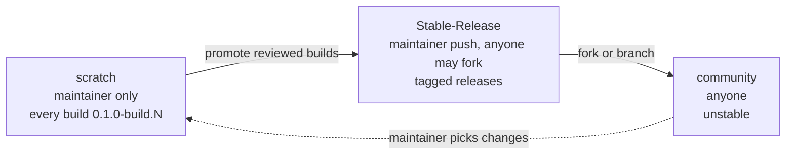

# Release and versioning map

This map shows how CKey's version numbers relate to one another, which build introduced each wire format and ABI, and how releases move between branches. [`VERSION`](../VERSION) is the source of truth for the current build, and [`CHANGELOG.md`](../CHANGELOG.md) describes each build.

## The four version numbers

| Number | Form | Where it lives | Changes when |
|---|---|---|---|
| **Software version** | `0.1.0-build.N` (`0.1.0-dev.N` up to build 60) | `VERSION`, `CKEY_SOFTWARE_VERSION`, `CHANGELOG.md`, `CONTEXT.md`, `tests/vectors/locator-v14.json` | Every commit. `tools/check_version.py` fails CI if these disagree. |
| **Format version** | `0.N.0`, written into the symbol as format byte `N` | `spec/CKey-Format-v0.N.0.md`, `CKEY_*FORMAT_VERSION` in `include/ckey/ckey.h` | Any change to the bytes or geometry a reader must understand. Each change gets a new number. Numbers are never reused. |
| **Profile** | profile byte `00`–`03` | The frame header | A new symbol family is added. Profile 0.1 is a layout of Profile 0 (format byte `1C`), not a separate profile byte. |
| **C ABI version** | integer | `CKEY_ABI_VERSION` and the `abi_version` field of every public struct | A public struct or function signature changes incompatibly. Additive functions do not bump it. |

Format numbers are shared across all profiles, so one profile's formats are not contiguous: Profile 2 went 0.9 → 0.15 → 0.18 → …

## What the current build supports

Build **0.1.0-build.74**, C ABI **4**.

| Profile | Current format | Byte | Capacity | Legacy formats still decoded from codewords |
|---|---|---|---|---|
| Profile 0 (scalable, standard layout) | [0.27.0](../spec/CKey-Format-v0.27.0.md) | `1B` | 31 versions, 27–4,619 bytes at level M | none |
| Profile 0.1 (scalable, print layout) | [0.28.0](../spec/CKey-Format-v0.28.0.md) | `1C` | 31 versions | none |
| Profile 1 (locator) | [0.14.0](../spec/CKey-Format-v0.14.0.md) | `0E` | exactly 16 bytes | 0.8, 0.11, 0.12, 0.13 |
| Profile 2 (text) | [0.25.0](../spec/CKey-Format-v0.25.0.md) | `19` | 0–200 bytes | 0.9, 0.15, 0.18, 0.19, 0.22, 0.23 |
| Profile 3 (extended) | [0.26.0](../spec/CKey-Format-v0.26.0.md) | `1A` | 1–2,048 bytes in seven tiers | 0.10, 0.16, 0.17, 0.20, 0.21, 0.24 |

The encoders emit only the current formats. The image decoders read only the current layouts. Legacy formats are accepted only when the caller already has the codeword bytes.

## Format history

**Status** is one of:

- **current:** emitted and decoded.
- **legacy:** no longer emitted, but codewords still decode.
- **retired:** neither emitted nor decoded. The specification is kept for the record.

| Format | Byte | Profile | Introduced | Status | Summary |
|---|---|---|---|---|---|
| [0.1.0](../spec/CKey-Format-v0.1.0.md) | `01` | 1 | dev.1 | retired | First locator: CRC-32C framing, RS(42,26). |
| [0.2.0](../spec/CKey-Format-v0.2.0.md) | `02` | 1 | dev.3 | retired | Open corner-arc finders, light marks on a dark field. |
| [0.3.0](../spec/CKey-Format-v0.3.0.md) | `03` | 1 | dev.4 | retired | Four inner rings plus a separate dial band. |
| [0.4.0](../spec/CKey-Format-v0.4.0.md) | `04` | 1 | dev.5 | retired | 2×2 Grid Key; split top-left finder. |
| [0.5.0](../spec/CKey-Format-v0.5.0.md) | `05` | 1 | dev.6 | retired | RS(77,26); ABI 2. |
| [0.6.0](../spec/CKey-Format-v0.6.0.md) | `06` | 1 | dev.8 | retired | Larger clear centre; rings moved outward; dots sized to the slot chord. |
| [0.7.0](../spec/CKey-Format-v0.7.0.md) | `07` | 1 | dev.9 | retired | Three nested quarter-arc finders; uniform 0.30-module ring dots. |
| [0.8.0](../spec/CKey-Format-v0.8.0.md) | `08` | 1 | dev.10 | legacy | Blueprint finders: one thick arc per corner. Kept readable for camera fixtures. |
| [0.9.0](../spec/CKey-Format-v0.9.0.md) | `09` | 2 | dev.26 | legacy | First text profile, RS(255,210), up to 200 bytes. |
| [0.10.0](../spec/CKey-Format-v0.10.0.md) | `0A` | 3 | dev.28 | legacy | First extended profile, ten RS(255,223) blocks, up to 2,048 bytes. |
| [0.11.0](../spec/CKey-Format-v0.11.0.md) | `0B` | 1 | dev.32 | legacy | Three inset quarter arcs per corner. |
| [0.12.0](../spec/CKey-Format-v0.12.0.md) | `0C` | 1 | dev.33 | legacy | One broad arc per corner, aligned to the rounded border. |
| [0.13.0](../spec/CKey-Format-v0.13.0.md) | `0D` | 1 | dev.34 | legacy | Finder arcs form the symbol's outer rounded corners. |
| [0.14.0](../spec/CKey-Format-v0.14.0.md) | `0E` | 1 | dev.35 | **current** | Continuous rounded border and one inboard arc per corner. |
| [0.15.0](../spec/CKey-Format-v0.15.0.md) | `0F` | 2 | dev.36 | legacy | Canonical finders on Profile 2. |
| [0.16.0](../spec/CKey-Format-v0.16.0.md) | `10` | 3 | dev.36 | legacy | Canonical finders on Profile 3. |
| [0.17.0](../spec/CKey-Format-v0.17.0.md) | `11` | 3 | dev.42 | legacy | Seven capacity and ECC tiers. |
| [0.18.0](../spec/CKey-Format-v0.18.0.md) | `12` | 2 | dev.42 | legacy | SplitMix32 visual fill. |
| [0.19.0](../spec/CKey-Format-v0.19.0.md) | `13` | 2 | dev.43 | legacy | Frame safety moat. |
| [0.20.0](../spec/CKey-Format-v0.20.0.md) | `14` | 3 | dev.43 | legacy | 34-ring filled polar field. |
| [0.21.0](../spec/CKey-Format-v0.21.0.md) | `15` | 3 | dev.44 | legacy | Corrected field geometry. |
| [0.22.0](../spec/CKey-Format-v0.22.0.md) | `16` | 2 | dev.45 | legacy | Corrected finder clearance. |
| [0.23.0](../spec/CKey-Format-v0.23.0.md) | `17` | 2 | dev.48 | legacy | Finder moat and polar join. |
| [0.24.0](../spec/CKey-Format-v0.24.0.md) | `18` | 3 | dev.48 | legacy | Finder moat and polar join. |
| [0.25.0](../spec/CKey-Format-v0.25.0.md) | `19` | 2 | dev.49 | **current** | Safe area, uniform keyed placement, whitening. |
| [0.26.0](../spec/CKey-Format-v0.26.0.md) | `1A` | 3 | dev.49 | **current** | Safe area, uniform keyed placement, whitening, polar join. |
| [0.27.0](../spec/CKey-Format-v0.27.0.md) | `1B` | 0 | dev.56 | **current** | Profile 0: one design at 31 sizes, four ECC levels. |
| [0.28.0](../spec/CKey-Format-v0.28.0.md) | `1C` | 0 (print layout) | dev.58 | **current** | Profile 0.1: equal-arc rings and heavier marks for small prints. |

The "Introduced" column is the build whose changelog entry first describes the format. Some format specifications were committed to `spec/` a few builds later.

## C ABI history

| ABI | Introduced | Change |
|---|---|---|
| 1 | dev.1 | First C ABI: locator encode, decode and SVG. |
| 2 | dev.6 | The public locator codeword grew from 42 to 77 bytes (RS(77,26)). |
| 3 | dev.58 | `ckey_scalable_symbol` gains `layout`. The Profile 0 encode, decode, capacity and logo-radius calls take a layout. `ckey_decode_scalable_gray8` reports the layout it found. |
| 4 | build.64 | `ckey_style` gains `policy` (strict / adaptive / override). |

Between these, many functions were added without a bump (image decoding, calibration scores, text and extended profiles, Profile 0, the design system, print output).

## Builds and commits

The repository history starts at dev.11. Builds without a row (dev.27, 29, 30, 33–36, 44) have no commit of their own: they were either never published or committed together with a neighbouring build. See the changelog.

| Build | Commit | Date | Summary |
|---|---|---|---|
| build.77 | tag `v0.1.0-build.77` | 2026-11-06 | Release build fixes: MSVC telemetry, Linux exports, Debug link |
| build.76 | `442fbae` | 2026-11-06 | README, gallery, publishing, lock-down (tagged; release build failed) |
| build.75 | `ea162ae` | 2026-11-05 | Swift package keeps `include/` in header-less targets |
| build.74 | `d220563` | 2026-11-05 | Swift SDK payload and camera fixes |
| build.73 | `3c5505f` | 2026-11-05 | Sweep decides certification; contrast below 3:1 is a warning |
| build.72 | `f3fb2f2` | 2026-11-05 | Certification by modelled photo sweep; Profile 0.1 reader regression test |
| build.71 | `180ff88` | 2026-11-05 | Remove the openckey.org prototype service |
| build.70 | `1bf71af` | 2026-11-05 | openckey.org separated; release attaches every SDK package |
| build.69 | `36f922a` | 2026-11-05 | Android SDK |
| build.68 | `251d3a2` | 2026-11-05 | Implementation status, platform integration guide, README and context |
| build.67 | `8771985` | 2026-11-05 | Swift package and .NET SDK |
| build.66 | `5c60b9c` | 2026-11-05 | CMake package, Homebrew formula, release/community/deprecate workflows, Web SDK |
| build.65 | `d3098f3` | 2026-11-05 | `.ckey` interchange v1, conformance suite, support matrix, benchmark harness |
| build.64 | `25b1578` | 2026-11-05 | Style policies and optical certification; ABI 4 |
| build.63 | `ea17c49` | 2026-11-05 | Core split into codec/scan/render/telemetry libraries; telemetry core; openckey.org service |
| build.62 | `783d3fa` | 2026-11-05 | Canonical geometry API; direct raster, PNG and PDF backends |
| build.61 | `6c950b5` | 2026-11-05 | Version scheme `0.1.0-build.N`; black-on-white default style; style presets |
| dev.60 | `36ec860` | 2026-11-05 | Changelogs, repository README and the release and versioning map |
| dev.59 | `bf47525` | 2026-11-05 | Add rendering/SDK/telemetry specification, status map, branch guide |
| dev.58 | `47f80a9` | 2026-11-04 | Add Profile 0.1 print-robust layout and print output |
| dev.57 | `fa445c7` | 2026-11-04 | Add the Profile 0 design system |
| dev.56 | `bd45001` | 2026-11-04 | Add Profile 0, the scalable family (Format 0.27) |
| dev.55 | `e9f6a26` | 2026-11-04 | Payload conventions and reader actions, incl. address: |
| dev.54 | `6289fcc` | 2026-11-04 | Reader: show decoded payloads as text with tappable links |
| dev.53 | `d21f898` | 2026-11-04 | Move full-frame localization into the core; fix reader orientation |
| dev.52 | `4f15b4a` | 2026-11-04 | Ignore macOS xcodebuild output |
| dev.51 | `4dd0b0b` | 2026-11-04 | Reader: 4K capture so Profile 3 can decode; renderer reports density |
| dev.50 | `20e926b` | 2026-11-04 | Resolve independent review of dev.49; gate dense decoders |
| dev.49 | `76328c9` | 2026-11-04 | Fix P2/P3 decoding, dead space, and safe area |
| dev.48 | `a1ea48d` | 2026-11-03 | Add finder safety moats and fix live diagnostics |
| dev.47 | `7ba4ec3` | 2026-11-03 | Show live scanner fit diagnostics |
| dev.46 | `13c084d` | 2026-11-03 | Calibrate Profile 2 against its own keys |
| dev.45 | `5cde557` | 2026-11-03 | Fix Profile 2/3 geometry and profile-specific scan calibration |
| dev.43 | `a5218cb` | 2026-11-03 | Use calibrated key fitting for camera localization |
| dev.42 | `87e2829` | 2026-11-03 | Add tiered dense profiles and renderer decode checks |
| dev.41 | `8c07cf1` | 2026-11-03 | Optimize iOS scanner profile detection and timing |
| dev.40 | `1a83dbd` | 2026-11-03 | Fix Swift C string buffer handling in Mac renderer |
| dev.39 | `1a9d5c8` | 2026-11-03 | Finalize renderer project build settings |
| dev.38 | `1327fce` | 2026-11-03 | Add native renderer lab and dense profile scanner paths |
| dev.37 | `24541a8` | 2026-11-03 | Correct canonical finders across CKey profiles |
| dev.32 | `9b81dde` | 2026-11-03 | Border-matched finder arcs |
| dev.31 | `9eb5758` | 2026-11-03 | Correct Profile 3 calibration and finder geometry |
| dev.28 | `98cdcb9` | 2026-11-03 | Add 2,048-byte extended CKey profile |
| dev.26 | `fb7fa5a` | 2026-11-03 | Add 200-byte CKey text profile |
| dev.25 | `db403e3` | 2026-11-03 | Refine CKey geometry from calibration keys |
| dev.24 | `74d24a1` | 2026-11-02 | Restore scanning reliability and use 1080p capture |
| dev.23 | `3b111bf` | 2026-11-02 | Bound live CKey localization work |
| dev.22 | `407a655` | 2026-11-02 | Add border-first distant CKey locator |
| dev.21 | `a222ef8` | 2026-11-02 | Prioritize small CKey square candidates |
| dev.20 | `44f7a15` | 2026-11-02 | Expand CKey far-range diagnostics and search |
| dev.19 | `ac3f41d` | 2026-11-02 | Expand far-distance CKey candidate search |
| dev.18 | `d22beb0` | 2026-11-02 | Fix Swift build in CKey Reader |
| dev.17 | `624d717` | 2026-11-02 | Improve CKey far-distance camera localization |
| dev.16 | `11ccf1d` | 2026-11-02 | Fix CKey Reader camera candidate geometry |
| dev.15 | `a26f5fe` | 2026-11-02 | Fix reader candidate status updates |
| dev.14 | `648246a` | 2026-11-02 | Improve iPhone reader localization diagnostics |
| dev.13 | `89bf68c` | 2026-11-02 | Fix SwiftUI reader color type inference |
| dev.12 | `c7805fe` | 2026-11-02 | Add experimental iPhone CKey reader |
| dev.11 | `fe01f26` | 2026-11-02 | Add quadrilateral-assisted grayscale decoding |

## Branches and the release flow

| Branch | Push | Changelog | Purpose |
|---|---|---|---|
| `scratch` | Maintainer only | [`CHANGELOG.md`](../CHANGELOG.md), one entry per build | All changes are written and tested here first. |
| `Stable-Release` | Maintainer only; anyone may fork | [`CHANGELOG-STABLE.md`](../CHANGELOG-STABLE.md), one entry per release | The supported source. Releases are tagged only here. |
| `community` | Anyone | [`CHANGELOG-COMMUNITY.md`](../CHANGELOG-COMMUNITY.md), one entry per merged change | Experimental community work. Do not depend on it in production. |

Community changes reach a release only through `scratch`. The maintainer brings them over, versions them as a new build, and promotes that build to `Stable-Release`.

### Cutting a release

1. On `scratch`, pass CI and `tools/check_version.py` at the build being released, for example build.61.
2. Fast-forward or merge `Stable-Release` to that commit.
3. Tag the commit `v0.1.0-build.61`. Tags are immutable: never move, delete or reuse one.
4. Create a GitHub Release from the tag. Its title is the release name, for example `CKey 0.1.0-build.61`.
5. Add an entry to the top of `CHANGELOG-STABLE.md` with:
   - the tag;
   - the formats the release emits and the formats it reads;
   - the ABI version;
   - the builds it includes (dev.A to dev.B);
   - known limits.
6. Add a row to the [release table](#releases) below.

### Deprecating a release

1. Retitle the GitHub Release `Deprecated - {release name}`, for example `Deprecated - CKey 0.1.0-build.61`.
2. Mark it deprecated in the release table and in `CHANGELOG-STABLE.md`. Name the release that replaces it and give the reason.
3. Keep the tag and its source. Deprecated means "do not use for new work", not deleted.

A format being superseded does not deprecate a release. Readers keep decoding legacy formats, as listed above.

## Releases

| Release | Tag | Builds | Formats emitted | ABI | Status |
|---|---|---|---|---|---|
| CKey 0.1.0-build.77 | `v0.1.0-build.77` | dev.1 to build.77 | P0 0.27.0, P0.1 0.28.0, P1 0.14.0, P2 0.25.0, P3 0.26.0 | 4 | supported |
| CKey 0.1.0-build.76 | `v0.1.0-build.76` | dev.1 to build.76 | the same | 4 | not released: its release build failed; nothing was published |

### Tag and version form

Decided at build 61: versions are `0.1.0-build.N`, and tags are `v0.1.0-build.N`.

- **Valid SemVer:** `build.N` is a prerelease, so every package registry accepts it.
- **Ordering:** builds sort numerically (`build.9` < `build.10`), and all of them sort before a final `0.1.0`.
- **Build count kept:** it stays visible, as specification §8.1 asks.
- **Old builds:** builds 1–60 were named `0.1.0-dev.N`. SemVer would sort `build.61` before `dev.60`, because it compares the labels alphabetically. None of the dev builds was published or tagged, so no registry ever has to compare the two. The map keeps the old names for history.
