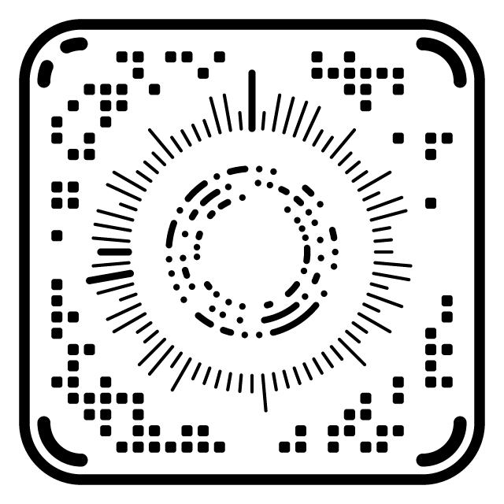
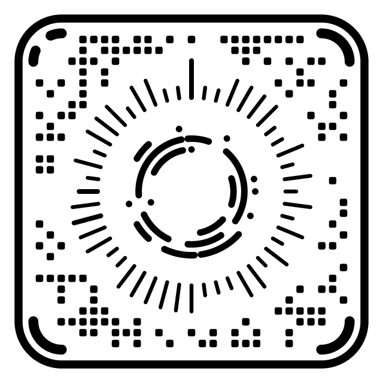
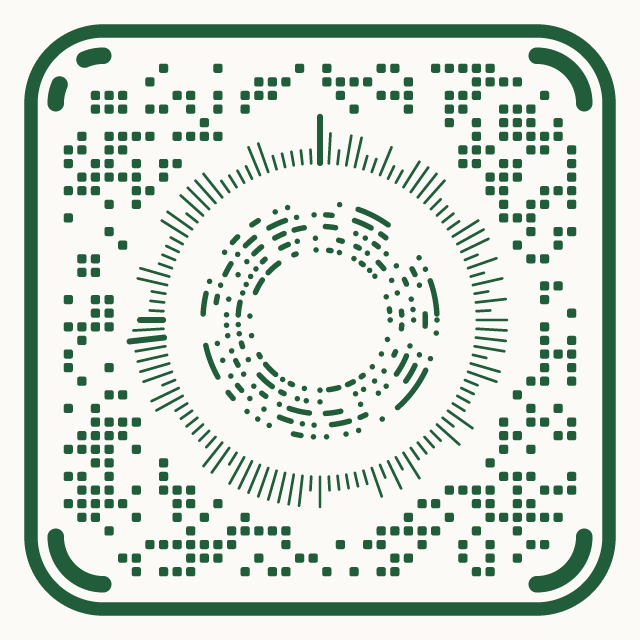
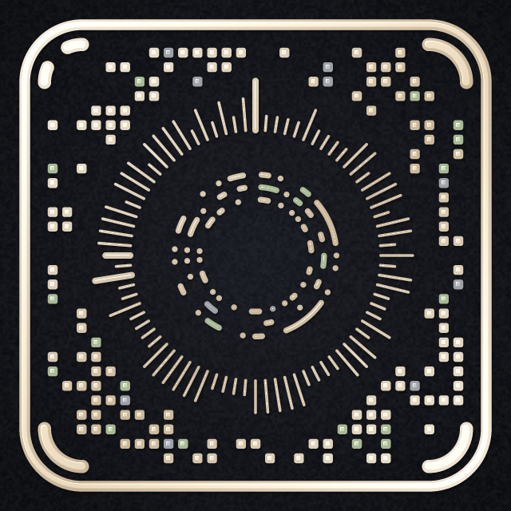
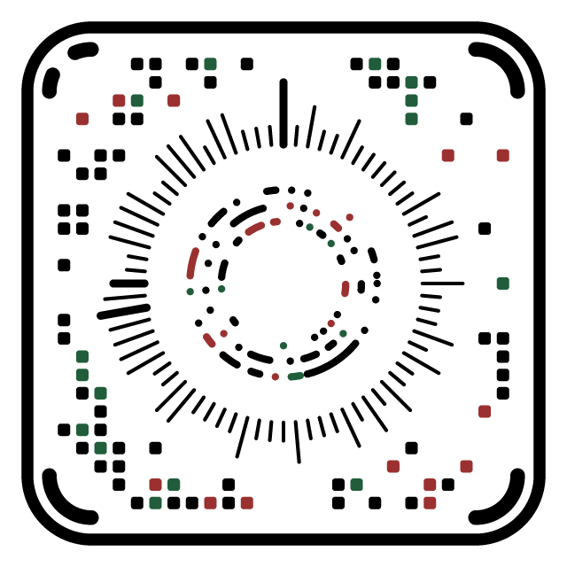
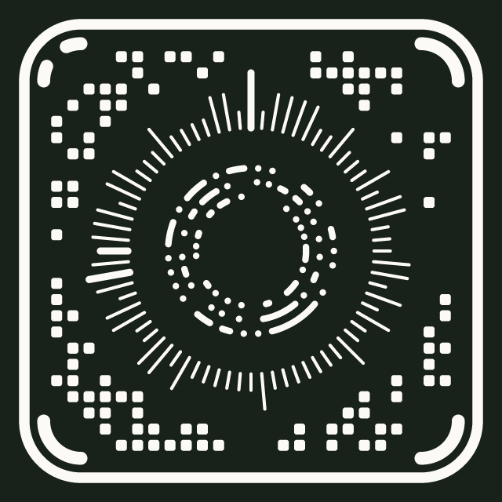
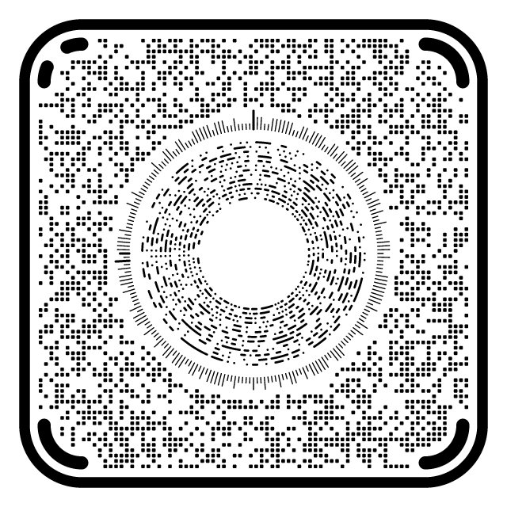

# Gallery

Every image here is rendered by the CKey core with `tools/gallery/ckey_gallery.cpp`, read back with the real decoder, and certified with the modelled photo sweep (a model, not a measurement). Rebuild them with:

```sh
cmake --build build --target ckey-gallery
./build/ckey-gallery docs/gallery
```

| | Symbol | Holds | Version | Reads back | Certification |
|---|---|---|---|---|---|
|  | **A link, plain**<br>The default style: black on white. | 20 bytes | 1 | yes | certified, excellent |
|  | **A link, print layout (Profile 0.1)**<br>Larger marks and gaps for small printed labels. | 20 bytes | 3 (print) | yes | certified, excellent |
|  | **A contact card, evergreen on paper**<br>Custom ink and background. | 101 bytes | 7 | yes | certified, good |
|  | **The Concept preset**<br>Cream metallic ink on a dark vignette, with accents, depth and grain. | 26 bytes | 3 | yes | certified, good |
|  | **Dotted rings, circle modules**<br>Ring marks drawn as separate dots, circular modules. | 40 bytes | 3 | yes | certified, excellent |
|  | **Accent colours**<br>A share of the data marks drawn in accent colours. | 25 bytes | 1 | yes | certified, good |
|  | **Light on dark**<br>Paper-coloured ink on an ink-coloured background. | 20 bytes | 1 | yes | certified, excellent |
|  | **A dense symbol**<br>About 560 bytes of text at level M. | 559 bytes | 17 | yes | certified, excellent |

CKey 0.1.0-build.75.
